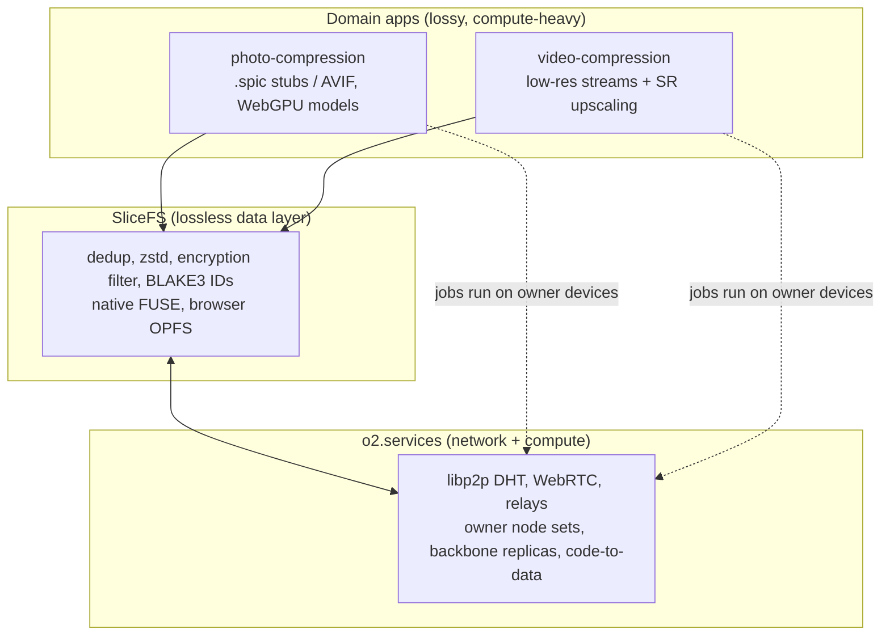

# o2-platform

The whole picture across four projects: how they fit together, where they connect, and which decisions are still open. This repo has no product code. It holds the architecture notes that no single project owns.

## The projects

| Project | What it is | Runs on | Repo |
|---|---|---|---|
| **o2.services** | P2P compute fabric: [libp2p](https://libp2p.io/) DHT, WebRTC, [Circuit Relay v2](https://github.com/libp2p/specs/blob/master/relay/circuit-v2.md). Code moves to the data; data stays on its owner's devices. An always-on backbone tier on [Cloudflare Durable Objects](https://developers.cloudflare.com/durable-objects/) (US, EU, South America) holds encrypted replicas for availability only. | Browser tab, Node.js, embedded (TypeScript + WASM) | [o2.services](https://github.com/o2alexanderfedin/o2.services) |
| **SliceFS** | Dedup file system: [FastCDC](https://www.usenix.org/conference/atc16/technical-sessions/presentation/xia) content-defined chunks, [BLAKE3](https://github.com/BLAKE3-team/BLAKE3)-256 content IDs, [zstd](https://facebook.github.io/zstd/) per object, write log, online GC. An encryption filter and a browser client are planned. | Linux ([libfuse](https://github.com/libfuse/libfuse)), macOS ([FUSE-T](https://www.fuse-t.org/) FSKit); browser ([OPFS](https://developer.mozilla.org/en-US/docs/Web/API/File_System_API/Origin_private_file_system)) planned | [slicefs](https://github.com/o2alexanderfedin/slicefs) |
| **photo-compression** | Browser-first photo vault (PWA). Photos become small semantic `.spic` stubs (color anchor, edge map, depth, caption), or AVIF when the stub is not good enough. Vault keypair; P2P sync on o2.services planned. | Browser ([IndexedDB](https://developer.mozilla.org/en-US/docs/Web/API/IndexedDB_API), OPFS cache, [WebGPU](https://developer.mozilla.org/en-US/docs/Web/API/WebGPU_API)) | [photo-compression](https://github.com/o2alexanderfedin/photo-compression) (private) |
| **video-compression** | Store and send video at low resolution (standard H.264/AV1 in MP4/WebM), upscale in real time with tiered neural super-resolution models (540p to 1080p or 4K). Frame interpolation in progress. | Browser (WebGPU, WASM fallback), desktop (Rust, wgpu, ort) | [video-compression](https://github.com/o2alexanderfedin/video-compression) (private) |

## Layers

All four trade compute for storage and transfer. Three of them run in the browser.

## How they fit

1. **Lossy codecs stay above the file system.** A POSIX file system must return the exact bytes that were written. `.spic` stubs and downscaled video are app-level representations, stored as files or objects. The SliceFS per-object filter chain holds only lossless filters (zstd, [encryption](docs/encryption.md)).
2. **Where dedup pays off.** The outputs of semantic and neural codecs (and entropy-coded video) share little content, so FastCDC and zstd gain little on them. Dedup pays off on originals and near-duplicates (the same photo imported twice, edits, bursts, sidecar files), on repeated video segments, on versions of app data, and on model files.
3. **Model files are content-addressed objects.** The video models are a few hundred KB to a few MB each and are already identified by SHA-256. The gain is integrity and "fetch once", not a large space saving.
4. **Media-aware chunking (lossless, a possible SliceFS feature).** A chunker that knows the container could cut the elementary video stream at GOP or keyframe boundaries and keep the container headers apart, so the same clip in two containers, or a trimmed copy, shares chunks. Today a SliceFS store has one FastCDC profile; this needs a chunker chosen per file type (a store format feature; see [open decisions](docs/open-decisions.md), D6).
5. **"Upscale on read" is a view, not a filter.** A read filter that returns other bytes than were written breaks POSIX. The upscale stays in the client player, or a separate read-only view path shows the upscaled form while the real file keeps its exact bytes.
6. **Sync by content ID over libp2p.** A SliceFS object ID can be what the DHT announces. A peer fetches only the objects it does not have, and checks each one against its ID.
7. **Owner node set = replicas; backbone = encrypted replicas.** The owner's devices hold full replicas. Backbone nodes can hold replicas only if SliceFS [encrypts](docs/encryption.md) the objects. Public objects (models) stay unencrypted and dedup globally.
8. **Code to data.** Photo `.spic` extraction and video work run as o2 jobs on the owner's devices, next to the SliceFS store.
9. **One browser storage layer.** The SliceFS WASM client ([OPFS sync access handles](https://developer.mozilla.org/en-US/docs/Web/API/FileSystemSyncAccessHandle) in a Worker, IndexedDB as fallback; [[slicefs#169](https://github.com/o2alexanderfedin/slicefs/issues/169)](https://github.com/o2alexanderfedin/slicefs/issues/169)) can be the store of a browser o2 node and of the photo and video PWAs: dedup, encryption, integrity by ID, sync.
10. **Random access.** Video seeks by GOP; the gallery needs previews. Apps choose object boundaries that match (one GOP, one stub section) instead of relying on FastCDC alone.

## Suggested order

1. SliceFS v2.2 (concurrency), then the store format work ([format header](https://github.com/o2alexanderfedin/slicefs/issues/154), [migration](https://github.com/o2alexanderfedin/slicefs/issues/155), [freeze](https://github.com/o2alexanderfedin/slicefs/issues/156)): the format must be stable before others depend on it.
2. SliceFS [browser client spike](https://github.com/o2alexanderfedin/slicefs/issues/169) on OPFS, with the photo vault's objects as the workload.
3. SliceFS [encryption filter](docs/encryption.md), with the key scope decided (see [open decisions](docs/open-decisions.md), D1).
4. Model files as content-addressed objects with chunked updates (helps both compression projects early).
5. Sync by object ID over the o2.services mesh.

## Documents

- [docs/open-decisions.md](docs/open-decisions.md) — decisions that are the owner's to make
- [docs/integration-points.md](docs/integration-points.md) — each connection between projects, with its issue links
- [docs/android-testing.md](docs/android-testing.md) — test phones and the Android paths
- [docs/encryption.md](docs/encryption.md) — chunk-level encryption in SliceFS and its trade-offs
